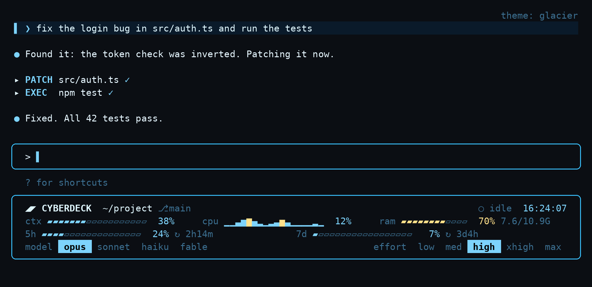
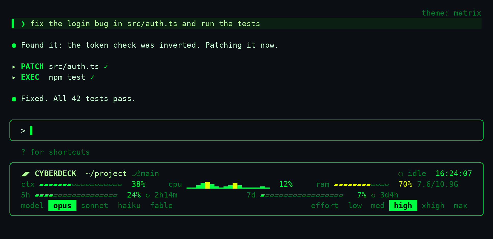
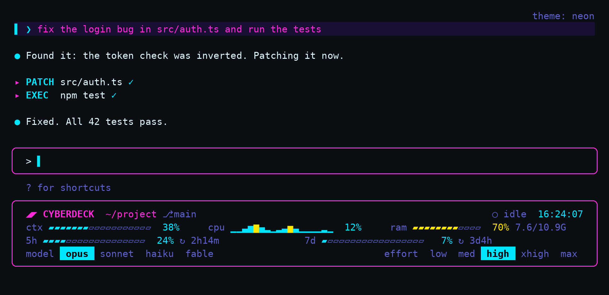
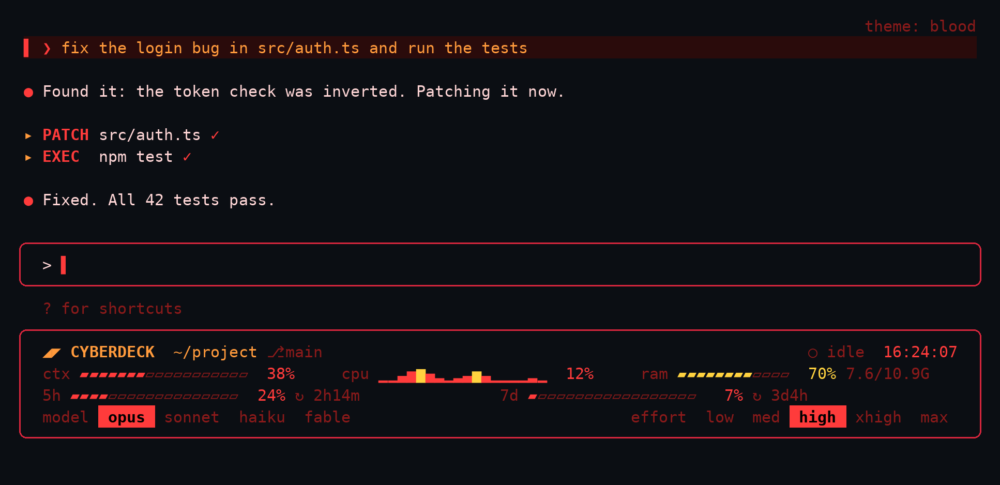
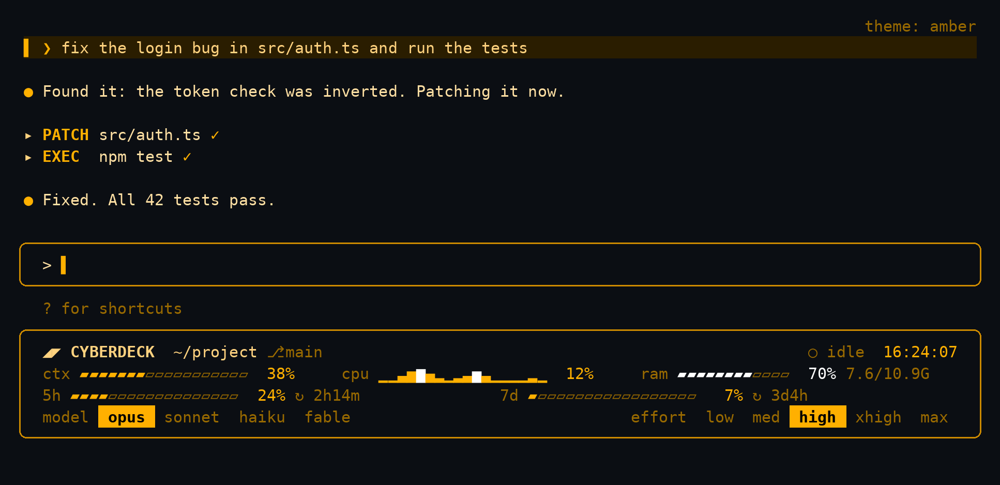
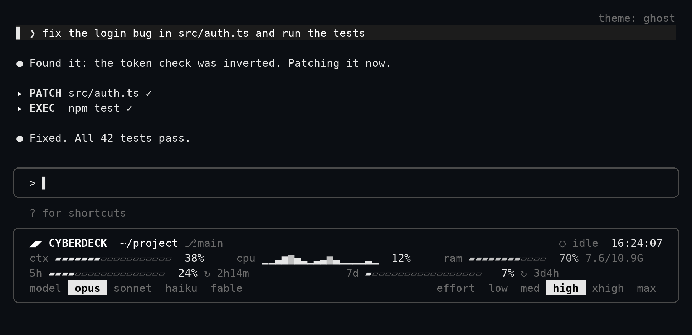

# ◢◤ CYBERDECK

A hacker-terminal skin for [Claude Code](https://claude.com/claude-code): a live HUD under the prompt,
a boot sequence, a kernel-style ops log, Matrix rain, a smart prompt box and six colour themes.



## Install

At the prompt of a Claude Code terminal session:

```
/plugin install cyberdeck --marketplace sohammeghani88/claude-cyberdeck
```

Answer `y` to add the marketplace, then pick a scope (user scope loads it in every session).

From a shell:

```
claude plugin install cyberdeck --marketplace sohammeghani88/claude-cyberdeck
```

In the desktop app, where `/plugin` does not run: click **+** next to the prompt box, then **Plugins**,
**Add marketplace** with `sohammeghani88/claude-cyberdeck`, then **Add plugin**.

## What you get

- **HUD under the prompt box**: context, CPU and RAM gauges, 5-hour and 7-day plan usage with reset
  times, and one-click **model** and **effort** switches.
- **Boot sequence and banner** at the start of each session.
- **Smart prompt box**: action words, danger words, file names and `code` light up as you type; file
  paths get ✓ or ✗; pasted API keys and passwords are flagged `⚠ secret`; a live character and token
  counter. All of it is drawn only, never sent.
- **Your messages** stand out as a tinted bar; finished tool calls fold into one line (`▸ EXEC npm test ✓`).
- **Hacker spinner** ("Decrypting thought vectors ▌") and alerts for test runs, commits and pushes.
- **`/deck ops`**: a side panel logging every tool call, which turns into Matrix rain when idle.

## Commands

| Command | Does |
| --- | --- |
| `/deck` | Turns everything off and on |
| `/deck theme <matrix\|neon\|blood\|amber\|ghost\|glacier>` | Recolours the deck and makes it the default |
| `/deck theme <name> here` | Recolours this session only |
| `/deck ops` | Opens the ops log / Matrix rain panel |
| `/deck boot` | Replays the boot sequence |

## Themes

Six palettes, switched with `/deck theme <name>`:

| `matrix` | `neon` |
| --- | --- |
|  |  |
| **`blood`** | **`amber`** |
|  |  |
| **`ghost`** | **`glacier`** |
|  |  |

## Matching Claude Code themes

`themes/` holds a Claude Code colour theme for each palette. Copy them into `~/.claude/themes/`, restart
Claude Code once, then pick **CYBERDECK …** in `/theme`.

## Notes

- Best in fullscreen mode (`/tui fullscreen`): the ops panel docks beside the chat, and new replies
  play a short decrypt animation.
- CPU and RAM come from `/proc`, so they show on Linux only.
